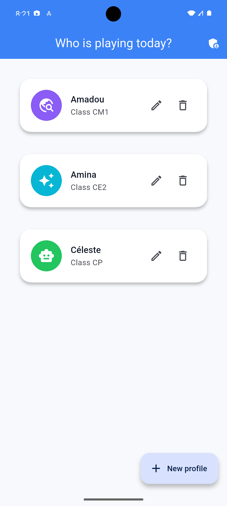
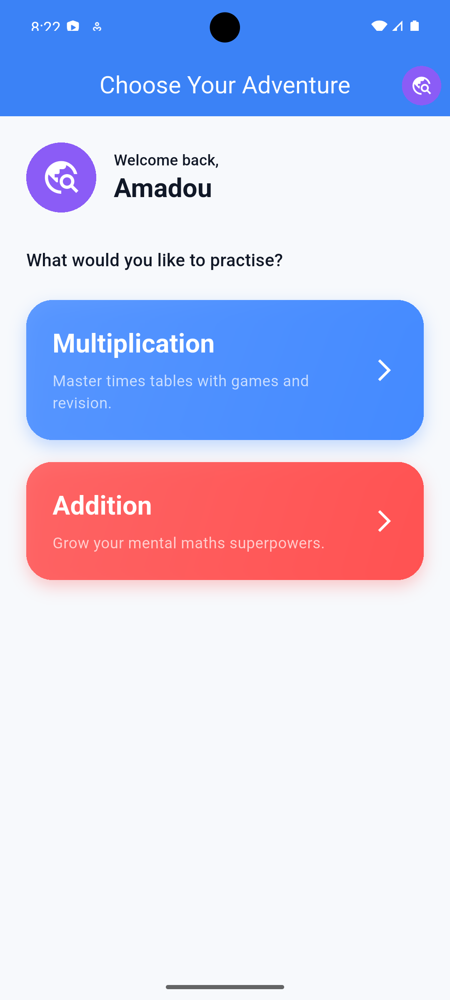
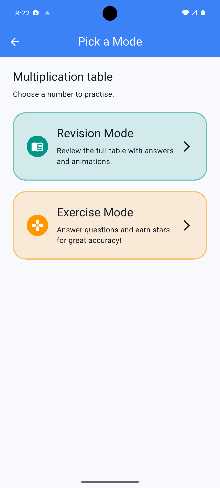
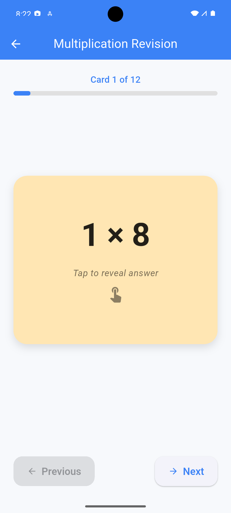
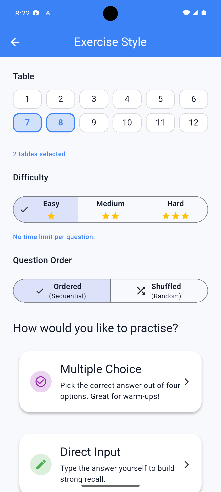
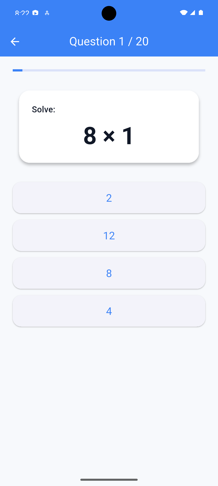
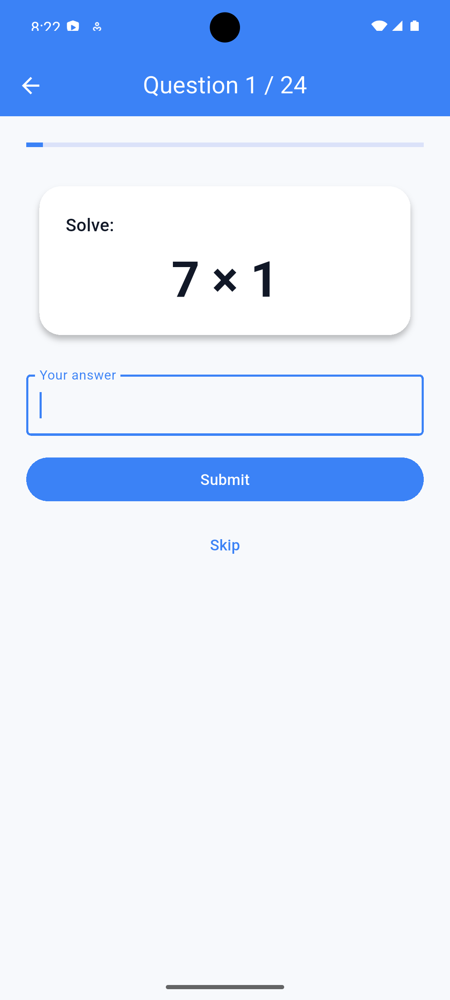

# MathsFun

MathsFun is a mobile playground that helps primary school learners revise
addition and multiplication tables through colourful study modes, interactive
quizzes, rewards, and parent controls.

## Screenshots

<div align="center">

  

  

  

  

  

  

  

  

</div>

## Features

- **Profile management** – create multiple learner profiles with avatars,
  school class tags, and a parent PIN for sensitive actions.
- **Guided navigation** – smart splash routing to creation, selection, or
  practice screens based on stored profiles.
- **Study modes** – revision tables and exercise flows for addition and
  multiplication with multiple choice, direct input, and timed challenge
  variants.
- **Bilingual experience** – every screen is localized in English and French,
  with quick switching available from the parent settings sheet.
- **Rewards and stats** – stars, badges, and session history persisted with
  Hive, plus per-profile dashboards for progress tracking.

## Tech Stack

- Flutter 3 with Material 3 theming and GoRouter for navigation
- Hive for local persistence of profiles, settings, sessions, and rewards
- Provider for application state management
- Build Runner & Hive Generator for strongly-typed adapters

## Running the App

```bash
flutter pub get
flutter run
```

The splash screen will automatically route you to profile creation on the
first launch. Parents can open the settings sheet (via the profile selector)
to choose the default language for the whole application.

## Tests

```bash
flutter test
```

Unit coverage includes question generation, statistics aggregation, and
formatting helpers.

## Project Structure

- `lib/core` – app bootstrap, theming, routing, utilities
- `lib/data` – models, repositories, and Hive setup
- `lib/features` – UI flows (profiles, exercises, results, statistics, etc.)
- `test` – unit tests for core logic

## Customisation Tips

- Add custom avatar assets by extending `kAvatarOptions` in
  `core/constants/avatar_options.dart`.
- Adjust exercise lengths or thresholds via `ExerciseConfig` defaults in
  the exercise flow screens.
- Tune timed challenge duration in `SettingsService` or via the in-app parent
  settings sheet.
